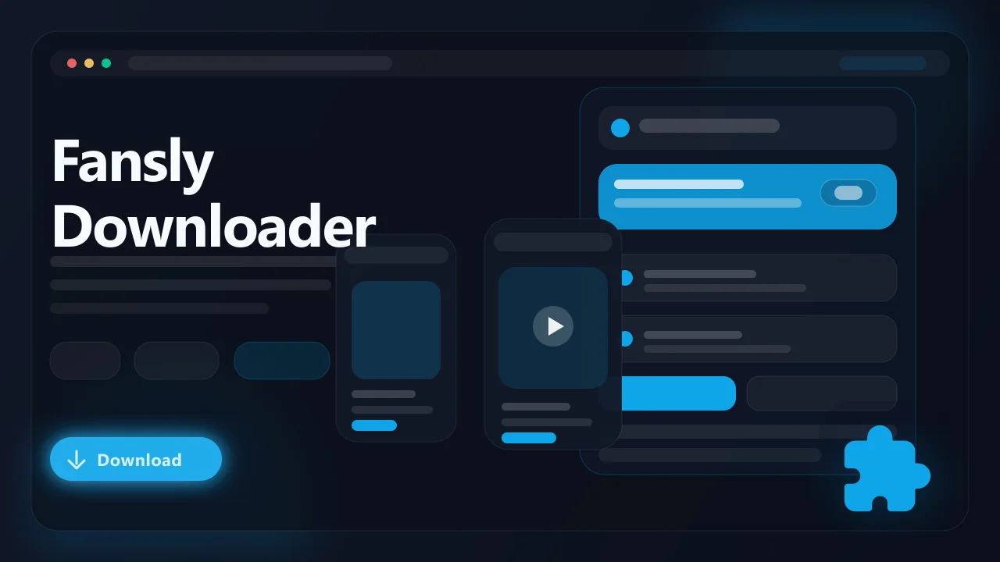

# Fansly Downloader (Browser Extension) | How to Download Fansly Videos

> Browser extension that downloads Fansly videos, images, GIFs and text posts, or bulk-saves a creator's media, from creators your account subscribes to.

Fansly Downloader is a browser extension for subscribers who want to keep the Fansly content they already have access to. Save a single video from a post, or pick a creator you subscribe to and bulk-save their media to a folder on your computer.

- Download Fansly videos as MP4, including streamed videos that need converting
- Save images and GIFs in their original format, and post text as TXT
- Bulk-download a creator's media: all media, photos only or videos only
- Bulk runs read the creator's vault albums when Fansly provides them
- Download buttons right on the media inside Fansly posts

## Links

- :rocket: Get it here: [Fansly Downloader](https://serp.ly/fansly-downloader?via=github)
- :new: Latest release: [GitHub Releases](https://github.com/serpapps/fansly-downloader/releases/latest)
- :question: Help center: [SERP Help](https://help.serp.co/en/)
- :beetle: Report bugs: [GitHub Issues](https://github.com/serpapps/fansly-downloader/issues)
- :bulb: Request features: [Feature Requests](https://github.com/serpapps/fansly-downloader/issues)

## Why Fansly Downloader

Fansly shows subscription content in a web feed. Viewing is easy, but saving what you have access to
means screen recording or digging through page code, and many videos are streamed in pieces rather than
served as a single file.

Fansly Downloader works inside your signed-in Fansly session. It finds the media on the page, converts
streamed videos to MP4, and can collect a whole creator's media in one bulk run.

## Features

- **Videos**: download Fansly videos as MP4, including streamed videos that need converting
- **Images and GIFs**: saved in their original format
- **Text posts**: saved as plain TXT files
- **Side panel**: Videos, Images/GIFs, Text and Bulk tabs for the page you have open
- **In-post buttons**: save a single item without opening the panel
- **Bulk downloader**: lists the creators you subscribe to, with search; choose all media, photos only or videos only
- **Vault albums**: bulk runs read a creator's vault albums when Fansly provides them, and their posts otherwise
- **Bulk Saver**: writes a creator's files to a folder you choose
- **Quality shown**: see the detected quality, such as 1080p, before you download
- **DRM notice**: tells you when a video is DRM-protected instead of saving a broken file
- **Private by design**: runs with your own Fansly session; your files never pass through our servers

## Supported Browsers

| Browser | Supported |
|---|---|
| Google Chrome | ✅ |
| Microsoft Edge | ✅ |
| Brave | ✅ |
| Opera | ✅ |
| Naver Whale | ✅ |
| Yandex Browser | ✅ |
| Firefox, Safari, mobile browsers | ❌ Not supported |

Works on Windows, macOS and Linux desktops. Every release ships one ZIP per browser
(for example `fansly-downloader-chrome.zip`).

## How to Download Fansly Videos (Step-by-Step)

1. Install the extension (see [Installation Instructions](#installation-instructions)) and sign in with your email.
2. Sign in to Fansly in the same browser and open a post from a creator you subscribe to.
3. Click the download button on the video in the post, or open the side panel's **Videos** tab and click **Download**.
4. For a whole creator, open the **Bulk** tab, search for the creator, choose all media, photos only or videos only, and start. Bulk Saver asks for a folder once.

## Supported Formats

- **Videos:** MP4
- **Images and GIFs:** original format
- **Text posts:** TXT

## Who It's For

- **Subscribers** who want offline access to creators they pay for
- **Collectors** organizing a local library by creator
- **People with unreliable internet** who prefer local playback

## Troubleshooting

**A video is not detected**  
Open the post, let it load fully and play the video briefly, then check the panel again.

**Bulk finds fewer items than expected**  
Fansly loads feeds dynamically. Scroll the creator page to load more posts, then run bulk again.

**A video says it is DRM-protected**  
A small number of Fansly videos use real DRM copy protection. Those cannot be saved.

## Free Trial & Pricing

You get **3 free downloads a week** with no credit card. A **subscription** gives unlimited downloads, with updates included.

- Sign in with your email and a one-time code; no password to create.
- Your free downloads reset every week. In current versions only finished downloads count; a failed or cancelled download does not use one.
- See current plans on the [product page](https://serp.ly/fansly-downloader?via=github).

## Installation Instructions

1. Download the ZIP for your browser from the [latest release](https://github.com/serpapps/fansly-downloader/releases/latest) (for example `fansly-downloader-chrome.zip`).
2. Unzip it. You get a folder that contains `manifest.json`.
3. Open your browser's extensions page: `chrome://extensions` (Chrome), `edge://extensions` (Edge), `brave://extensions` (Brave), `opera://extensions` (Opera), `whale://extensions` (Whale) or `browser://extensions` (Yandex).
4. Turn on **Developer mode**.
5. Click **Load unpacked** and select the unzipped folder.
6. Pin the extension, click its icon, and sign in with your email and the one-time code we send you.

Prefer a guided setup? The [product page](https://serp.ly/fansly-downloader?via=github) walks you through the same steps.
When a newer version is published, the extension shows an update notice; download the new ZIP from
[GitHub Releases](https://github.com/serpapps/fansly-downloader/releases/latest) and load it the same way.

## FAQ

### How do I download a video from Fansly?

Sign in to Fansly and open the post. Either click the download button on the video in the post, or open the extension's side panel, go to the **Videos** tab and click **Download** next to the video. It saves as an MP4.

### How do I download a whole Fansly profile?

Open the **Bulk** tab. It lists the creators you subscribe to; search for one and select them. Choose **All media**, **Photos only** or **Videos only**, then start. Bulk Saver asks for a folder once and saves the creator's files there.

### Can I download Fansly images, GIFs and text posts too?

Yes. The side panel has separate Images/GIFs and Text tabs. Images and GIFs keep their original format, and post text is saved as a plain TXT file.

### Does bulk download include vault albums?

Yes. For a bulk run the extension first collects the creator's media from their vault albums. If Fansly returns nothing there, it collects from the creator's posts instead.

### What video quality do I get?

The quality Fansly provides for each video, such as 1080p. The extension picks the best version it finds and cannot make a video sharper than the version Fansly serves.

### Why does a video say it is DRM-protected?

A small number of Fansly videos use real DRM copy protection. Those cannot be saved, and the extension shows a message instead of saving a broken file.

### Do I need to be subscribed to the creator?

Yes. The extension uses your own signed-in Fansly session, so it can save only what your account can already view. It does not unlock paid posts or other subscription tiers.

### Can I record Fansly live streams?

Not with this extension. Live streams are handled by the separate [Fansly Live Downloader](https://github.com/serpapps/fansly-live-downloader).

### Where are my files saved?

Single downloads go to your browser's normal Downloads folder. Bulk downloads go to the folder you choose in Bulk Saver.

### Which browsers are supported?

Chrome, Edge, Brave, Opera, Whale and Yandex on Windows, macOS and Linux. Firefox, Safari and mobile browsers are not supported.

### Is there a free trial?

Yes. You get **3 free downloads a week** with no credit card. A **subscription** gives unlimited downloads, with updates included.

## Notes

- Only download content you own or have permission to save.
- The extension works with videos your own account can already watch in the browser. It does not unlock paid, private or locked content.
- Quality depends on what the source player serves; the extension cannot make a video sharper than the original.
- Site updates can affect detection. If something stops working, [open an issue](https://github.com/serpapps/fansly-downloader/issues) and include the page type (not private links).

## License

This repository is distributed under the proprietary SERP Apps license in the [LICENSE](LICENSE) file. Review that file before copying, modifying, or redistributing any part of this project.

## Related

- [Fansly Live Downloader](https://github.com/serpapps/fansly-live-downloader)
- [OnlyFans Downloader](https://github.com/serpapps/onlyfans-downloader)
- [JustForFans Downloader](https://github.com/serpapps/justforfans-downloader)

## About Fansly

Fansly is a subscription-based creator platform where creators publish photos, videos, GIFs and posts
for followers and paying subscribers. Fansly Downloader gives subscribers a browser-based way to keep a
local copy of the content they already have access to.
